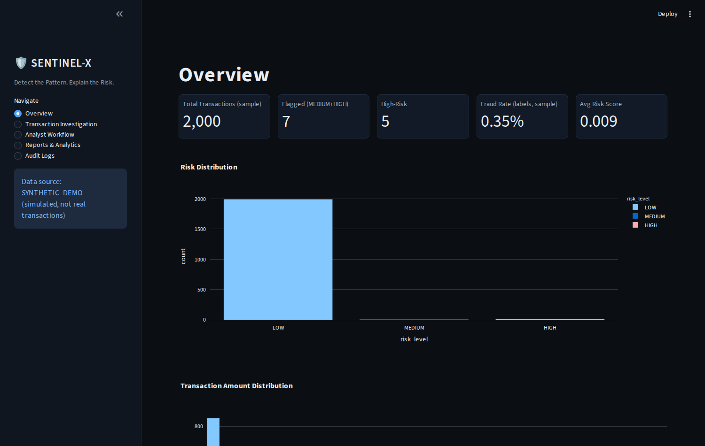
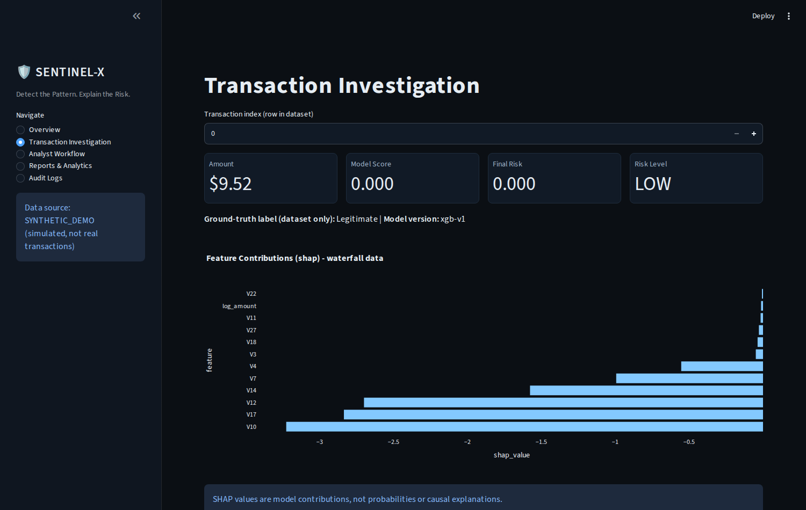
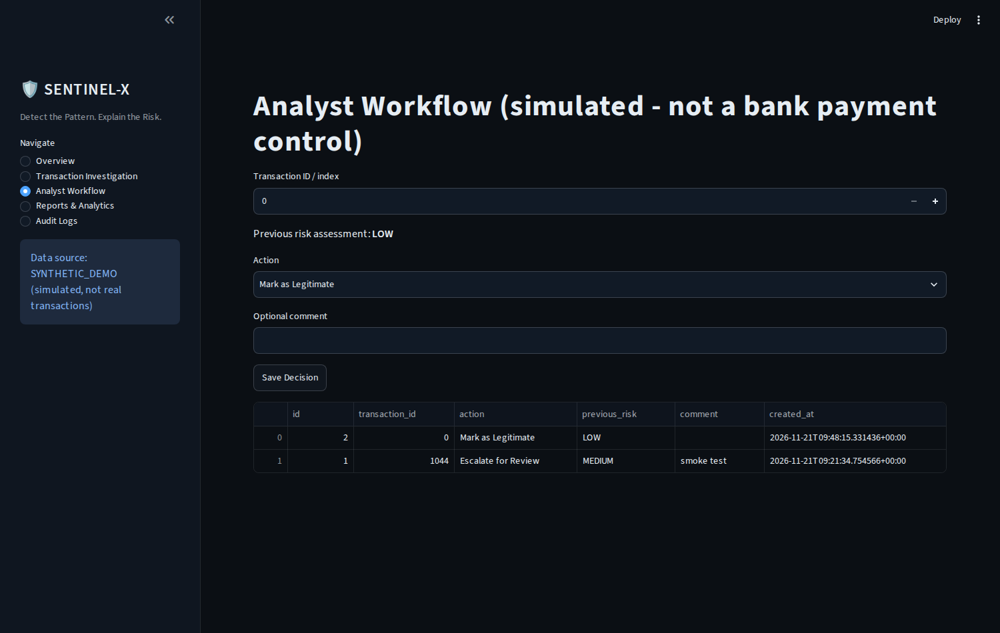
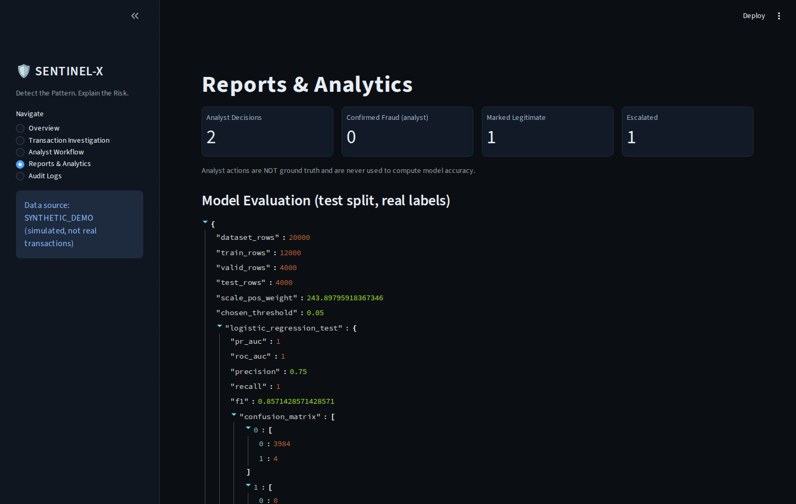
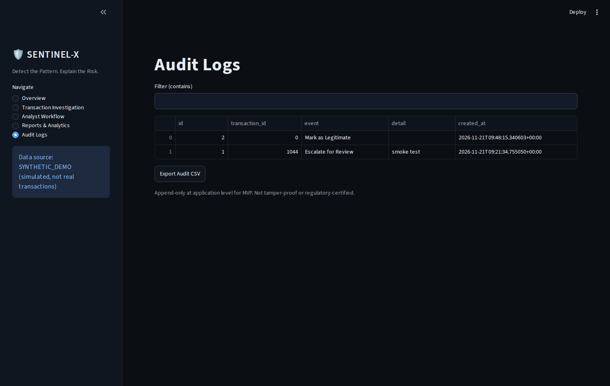

# SENTINEL-X
**Financial Fraud Detection, Reasoning & Intelligence Platform** — *Detect the Pattern. Explain the Risk.*

[](https://github.com/peloyl/SENTINEL-X/actions/workflows/tests.yml)


## Problem
Fraud is rare (~0.2-0.4%), costly, and black-box model scores alone do not help an analyst decide. SENTINEL-X combines ML, rules, risk aggregation and deterministic reasoning so every flag comes with an explanation and an audit trail.

## Key Features
- Time-aware training, leakage-safe preprocessing, Logistic Regression baseline vs XGBoost primary
- PR-AUC-first evaluation, validation-chosen threshold, scale_pos_weight (SMOTE optional experiment)
- SHAP local/global explanations (kept separate from behavioral evidence)
- YAML rule engine + deterministic reasoning engine (no LLM, no paid API)
- Hybrid risk: 0.6*model + 0.2*rule + 0.2*velocity (configurable, not validated optima)
- 5-page Streamlit dashboard, analyst workflow persisted in SQLite, audit export, PSI drift monitoring

## Tech Stack
Python 3.11+, pandas, NumPy, scikit-learn, XGBoost, SHAP, imbalanced-learn, Streamlit, Plotly, SQLite, YAML, pytest.

## Architecture
See `docs/architecture.md`.

## Installation
```bash
python -m venv .venv && source .venv/bin/activate
pip install -r requirements.txt
```

## Dataset Setup
Real data: download https://www.kaggle.com/datasets/mlg-ulb/creditcardfraud and place `creditcard.csv` in `data/raw/`.
Without it, the app uses **SYNTHETIC demo data** (generated, clearly labeled everywhere) so the full pipeline still runs.

## Train
```bash
python scripts/generate_demo_data.py   # only if no real dataset
python scripts/train_model.py          # writes models/*.joblib + models/evaluation_report.json
```

## Run Dashboard
```bash
streamlit run app/main.py
```

## Tests
```bash
pytest -q
```

## Evaluation Methodology
See `docs/model_evaluation.md`. Metrics in the report are produced by the actual training run on your machine/dataset.

## Screenshots
Actual screenshots of the running dashboard (synthetic demo data, labeled in-app):

**Overview**


**Transaction Investigation (SHAP contributions)**


**Analyst Workflow**


**Reports & Analytics**


**Audit Logs**


## Limitations
See `docs/limitations.md` - including: no real IP/device/geo/90-day history in the source dataset, synthetic demo labeling, non-validated risk weights, application-level (not tamper-proof) audit.

## Roadmap
IEEE-CIS migration, per-user velocity on real histories, calibration, LightGBM comparison, verified-feedback retraining pipeline.

## License
MIT (see LICENSE).
